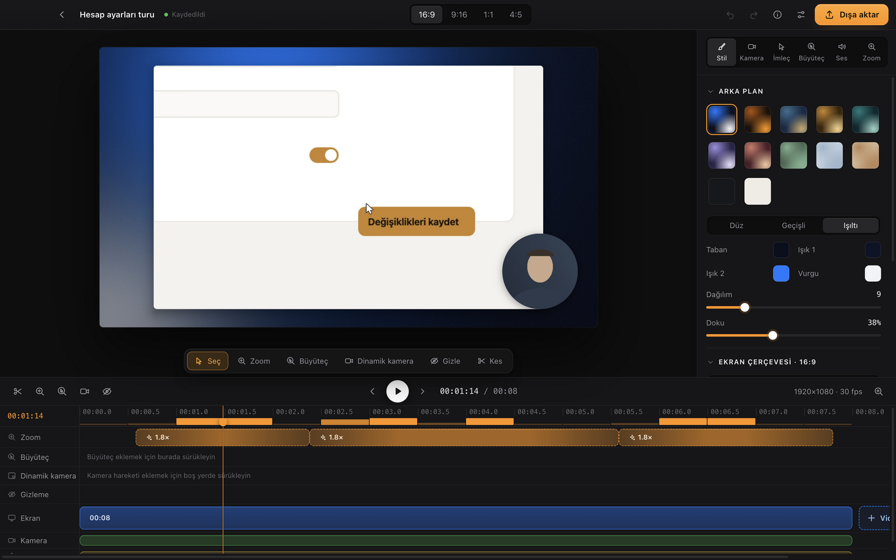
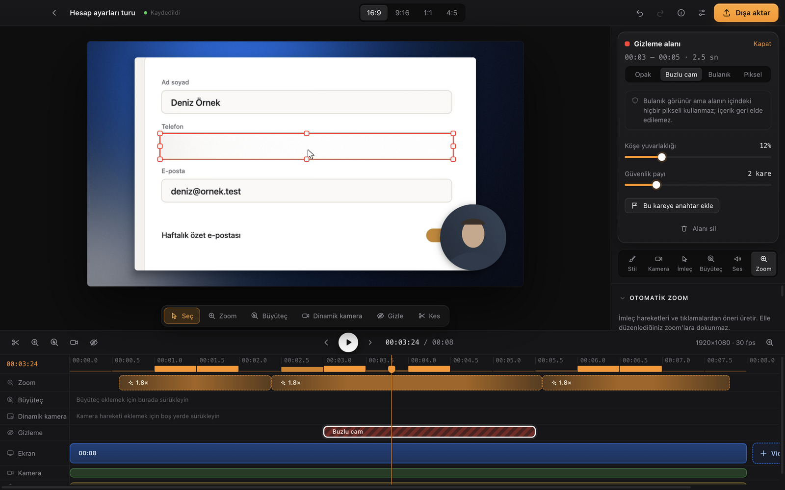
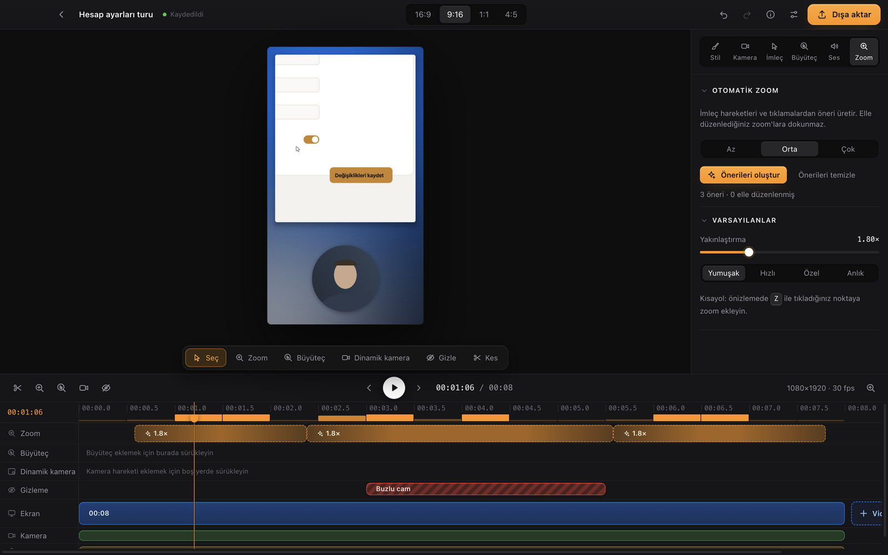
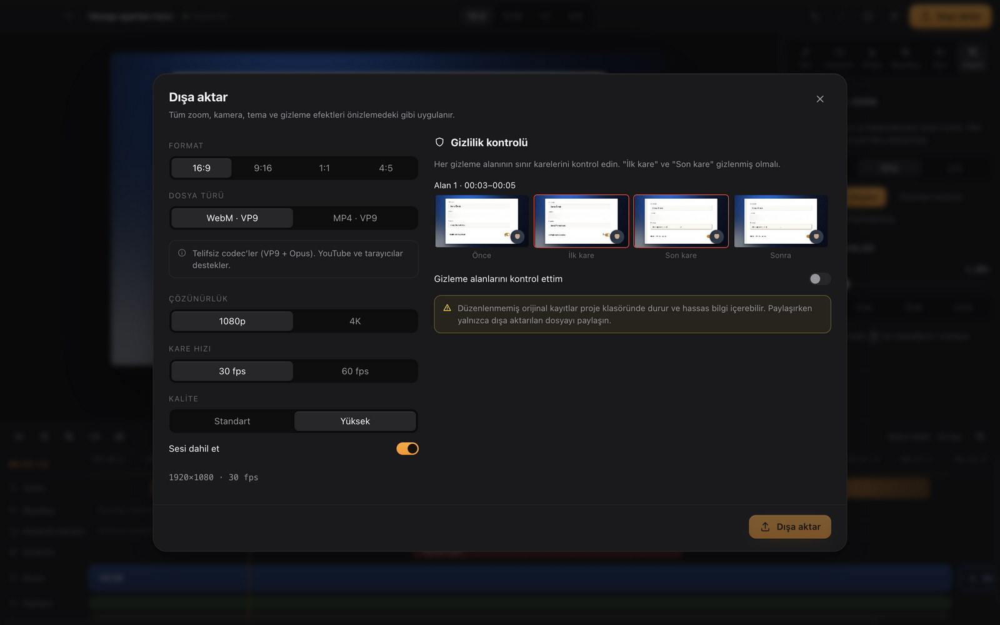

# Zeyvola

macOS için ekran kaydı ve video düzenleme uygulaması. Ekran, kamera ve mikrofon ayrı izlere kaydedilir. Kayıttan sonra zaman çizelgesinde zoom, kamera yerleşimi, gizleme ve tema düzenlenir.

*Screen recording and video editing for macOS. Screen, camera and microphone are recorded to separate tracks; zoom, camera layout, privacy masks and themes are edited afterwards on a timeline.*

> Sürüm 0.1, ilk genel sürüm. Şimdilik yalnızca **macOS (Apple Silicon)**. Windows sürümü hazırlanıyor; gerçek Windows'ta test edilene kadar yayımlanmayacak.
>
> Bu sürümde bilinen sınırlar: **sistem sesi kaydedilmez** (mikrofon kaydedilir) ve imleç videoya gömülü kaydedilir.
> *Known limits in this version: system audio is not recorded (the microphone is) and the cursor is part of the video.*

## Özellikler / Features
- Ekran, kamera ve mikrofon kaydı (ayrı izler)
- Tıklamalardan ve imleç hareketinden otomatik zoom önerileri; elle düzenlenebilir. Tıklamaları küçük bir yardımcı program (`native/input-macos`) bildirir; yalnızca fare tuşlarını ve kaydırmayı görür, klavyeyi okumaz, video ya da ses kaydetmez.
- Zaman çizelgesi: kesme, bölme, video ekleme (MP4, MOV, WebM)
- Gizleme: seçilen alanı buzlu cam, bulanıklık ya da piksel efektiyle kapatma. Dışa aktarılan her kare bu efektlerden geçer.
- Büyüteç: zaman çizelgesinde seçilen aralıklarda imleci takip eden mercek; her aralığın boyutu ve yakınlaştırması ayrı ayarlanır. Gizlenen alanları açığa çıkarmaz.
- Temalar, arka plan, kamera yerleşimi; 16:9, 9:16, 1:1, 4:5 formatları
- Dışa aktarma: **MP4** (H.264 + AAC, işletim sisteminin kodlayıcısıyla) ve **WebM** (VP9 + Opus), 1080p veya 4K, 30 veya 60 fps; kaydedilecek klasörü ve adı siz seçersiniz
- Türkçe ve İngilizce arayüz

## Ekran görüntüleri / Screenshots
Görüntüler uydurma bir örnek projeden (`pnpm docshots`) üretilir; gerçek bir ekran, kişi ya da kamera görüntüsü içermez.

*The pictures come from a made-up sample project (`pnpm docshots`); no real screen, person or camera picture is shown.*


*Düzenleyici: otomatik zoom önerileri zaman çizelgesinde. · Editor: automatic zoom suggestions on the timeline.*


*Gizleme: seçilen alan buzlu camla kapatılır. · Privacy: the selected area is covered with frosted glass.*


*Aynı kayıt dikey (9:16) formatta. · The same recording in vertical (9:16) format.*


*Dışa aktarma: MP4 (H.264 + AAC) ya da WebM (VP9 + Opus) ve gizleme alanlarının sınır kareleri. · Export: MP4 (H.264 + AAC) or WebM (VP9 + Opus) with the edge frames of each privacy area.*

## Gizlilik / Privacy
Kayıtlar, imleç verileri ve projeler yalnızca bilgisayarınızda kalır. Uygulama ağ isteği yapmaz ve telemetri göndermez. Tuş vuruşları kaydedilmez.

*Recordings, cursor data and projects stay on your computer. The app makes no network requests and sends no telemetry.*

## İndirme / Download
Sürümler GitHub **Releases** sayfasında yayımlanır. Her sürümde şunlar bulunur:
- uygulama (`Zeyvola-<sürüm>-macos-arm64.zip`);
- FFmpeg kaynak kodu paketi (LGPL-2.1, bkz. *Üçüncü taraf yazılımlar*);
- `SHA256SUMS.txt`.

Uygulama Apple Developer ID ile imzalanıp noterlenmediyse, macOS ilk açılışta uygulamanın açılmasını engeller. Bu durumda:
- macOS 15 ve sonrası: uygulamayı bir kez açmayı deneyin, ardından **Sistem Ayarları › Gizlilik ve Güvenlik** bölümünde **Yine de Aç**'a tıklayın.
- macOS 14 ve öncesi: uygulamaya sağ tıklayıp **Aç**'ı seçin.

*If the app is not signed with an Apple Developer ID and notarized, macOS blocks the first launch. On macOS 15 and later, try to open it once, then click **Open Anyway** in **System Settings › Privacy & Security**. On macOS 14 and earlier, right-click the app and choose **Open**.*

**Ekran kaydı izni.** İlk kayıtta macOS izin ister: **Sistem Ayarları › Gizlilik ve Güvenlik › Ekran ve Sistem Ses Kaydı** bölümünde Zeyvola'yı açın, sonra Zeyvola'yı kapatıp yeniden açın. Developer ID ile imzalanmamış bir sürümde bu izin her güncellemeden sonra yeniden verilmelidir; macOS eski izni tutarsa Zeyvola satırını "−" ile kaldırıp uygulamayı yeniden açın, gerekirse bilgisayarı yeniden başlatın.

*Screen recording permission: on the first recording macOS asks for it — turn on Zeyvola in **System Settings › Privacy & Security › Screen & System Audio Recording**, then quit and reopen Zeyvola. Without a Developer ID signature the permission has to be given again after each update; if macOS keeps the old one, remove the Zeyvola row with "−", reopen the app, and restart the Mac if needed.*

## Geliştirici / Developer
Zeyvola'yı **Yıldız Dikme** (Independent Software Developer) geliştirir. GitHub: [YildizDikme](https://github.com/YildizDikme).

Copyright © 2026 Yıldız Dikme. Zeyvola'nın kendi kodu aşağıdaki lisansla yayımlanır; üçüncü taraf bileşenler kendi lisanslarıyla dağıtılır.

*Zeyvola is developed by Yıldız Dikme (Independent Software Developer). Copyright © 2026 Yıldız Dikme. Zeyvola's own code is licensed as described below; third-party components keep their own licenses.*

## Lisans / License
Zeyvola'nın kaynak kodu **[PolyForm Shield License 1.0.0](LICENSE)** ile yayımlanır. Bu lisans "kaynağı açık" (source-available) bir lisanstır; OSI anlamında açık kaynak değildir. Lisansın gerekli bildirim satırları [`NOTICE`](NOTICE) dosyasındadır.

Kısaca (bağlayıcı olan lisans metnidir; bu özet ona bir şey eklemez):
- Zeyvola'yı kişiler, şirketler ve kurumlar ücretsiz kullanabilir; kopyalayabilir, değiştirebilir ve dağıtabilir.
- Lisans, Zeyvola ile yaptığınız videolar, kayıtlar ve projeler üzerinde hak iddia etmez ve ticari kullanımlarını sınırlamaz.
- İzin verilmeyen tek amaç, Zeyvola ile ya da lisans verenin Zeyvola'yı kullanarak sunduğu bir ürünle **rekabet eden bir ürün sağlamaktır**. Lisansa göre bir ürün ücretsiz olsa da rakip olabilir; Zeyvola'nın yerine geçecek şekilde sunulan bir ürün kesinlikle rakiptir.
- Bir kullanımın rekabet sayılıp sayılmadığı her durumda lisans metnine göre değerlendirilir.

*In short (the license text governs; this summary adds nothing to it): individuals, companies and institutions may use, copy, modify and distribute Zeyvola free of charge. The license claims no rights in the videos, recordings and projects you make with it and does not limit their commercial use. The one purpose it does not permit is providing a product that competes with Zeyvola or with a product the licensor provides using it; under the license a product can compete even when it is free, and one marketed as a practical substitute for Zeyvola definitely competes.*

"Zeyvola" adı ve logosu için: [TRADEMARKS.md](TRADEMARKS.md).

## Üçüncü taraf yazılımlar / Third-party software
Zeyvola, Electron (Chromium) ve birkaç JavaScript paketi üzerine kuruludur. Her bileşen kendi lisansıyla dağıtılır.
- Lisans metinleri: [docs/THIRD_PARTY_NOTICES.md](docs/THIRD_PARTY_NOTICES.md). Uygulama içinde: **Ayarlar › Lisanslar**.
- FFmpeg (LGPL-2.1 veya üstü): Electron'un tescilli codec'ler olmadan derlenmiş kitaplığı değiştirilmeden, ayrı ve dinamik bağlı bir dosya olarak dağıtılır. Karşılık gelen kaynak kodu her sürümle birlikte yayımlanır. Kitaplığı uyumlu bir sürümle değiştirebilirsiniz; ardından uygulamayı yeniden imzalayın.
- MP4 dışa aktarma H.264 görüntü ve AAC ses yazar. Bunları uygulamanın kendi kodu değil, işletim sisteminin kodlayıcısı üretir (macOS: VideoToolbox ve AudioToolbox; Windows: Media Foundation). Uygulamaya H.264 ya da AAC kodlayıcısı eklenmez; Electron'un içindeki yazılım H.264 kodlayıcısı (OpenH264) kullanılmaz. Cihazda bu kodlayıcılar yoksa uygulama dışa aktarmadan önce bunu söyler ve WebM önerir.
- H.264 ve AAC patentli codec'lerdir; telif ücretli patent havuzları vardır. İşletim sisteminin kodlayıcısını kullanmanın bu yükümlülükleri nasıl etkilediği hukuken netleşmemiştir; bu proje bu konuda bir güvence vermez. Ayrıntılar: [docs/THIRD_PARTY_NOTICES.md](docs/THIRD_PARTY_NOTICES.md) (codec tablosu).
- WebM dışa aktarma VP9 + Opus ile yapılır. Bu biçimlerin geliştiricileri (Google, Xiph.Org) kendi patentleri için telifsiz izin verir; üçüncü kişilerin patent iddiaları için bir güvence verilmez.
- *MP4 export writes H.264 video and AAC sound, produced by the operating system's own encoders (macOS VideoToolbox and AudioToolbox, Windows Media Foundation), not by the app's code; Electron's software H.264 encoder (OpenH264) is not used. H.264 and AAC are patented codecs with royalty-bearing patent pools; how using the operating system's encoders affects those obligations is not legally settled, and this project gives no assurance about it. WebM export uses VP9 + Opus.*

## Kaynaktan derleme / Building from source
Gereksinimler / Requirements:
- macOS (Apple Silicon)
- Node.js 22.12+ (sürüm `.nvmrc` dosyasında; nvm kullanıyorsanız depo kökünde `nvm use`)
- pnpm 10 (sürüm kök `package.json` içindeki `packageManager` alanında)
- Xcode komut satırı araçları (`xcode-select --install`): paketleme, yerel yardımcılar ve denetim araçları `swiftc`, `clang`, `codesign`, `lipo`, `otool`, `objdump`, `ditto`, `hdiutil`, `PlistBuddy` kullanır. `pnpm start` de geliştirme paketini `codesign` ile imzalar.

*Requirements: macOS (Apple Silicon); Node.js 22.12+ (see `.nvmrc`; run `nvm use` in the repository root if you use nvm); pnpm 10 (see `packageManager` in the root `package.json`); Xcode Command Line Tools, since packaging, the native helpers and the audit tools call `swiftc`, `clang`, `codesign`, `lipo`, `otool` and similar tools.*

```bash
nvm use                       # .nvmrc'deki Node sürümü
pnpm install
pnpm --filter @zeyvola/desktop exec node node_modules/electron/install.js   # Electron ikili dosyası
pnpm dev                      # geliştirme: derle ve uygulamayı aç (pnpm build && pnpm start)
pnpm test && pnpm typecheck   # birim testleri ve tip denetimi
pnpm package                  # macOS paketi → apps/desktop/out/webm/darwin-<arch>/
pnpm codec-audit -- apps/desktop/out/webm/darwin-arm64 --profile webm --probe --release
```

`pnpm package` varsayılan olarak yayımlanan yapılandırmayı (`ZEYVOLA_DIST=webm`: Chromium kayıt yolu; dışa aktarma MP4 H.264 + AAC ve WebM VP9 + Opus) derler. Paketler yerel test için geçici imzalanır.

*`pnpm package` builds the published configuration by default (`ZEYVOLA_DIST=webm`: Chromium recording; MP4 export as H.264 + AAC, WebM as VP9 + Opus). Packages are ad-hoc signed for local testing.*

Uygulama içi test takımları / In-app test suites (geçici bir proje klasörü, sentetik kamera ve mikrofonla çalışır; kendi projeleriniz okunmaz. Ekran ve GPU gerektirir):
- `pnpm smoke`: uygulamayı derler ve arayüz katmanını kendi kendine dener (WebGL2 kompozitör, gizleme efektleri, WebCodecs kodlayıcıları, MP4/WebM yazıcıları); bu Mac için bir yetenek tablosu raporlar.
- `pnpm perftest`: otomatik zoom, oynatma ve dışa aktarma sürelerini ölçer.
- `pnpm uitest`: ana akışı arayüz üzerinden sürer; dışa aktarılan her MP4'ü macOS'un kendi çözücüsüyle (AVFoundation) de açar.
- `node tests/media-check/av-check.mjs <dosya.mp4>`: bir MP4'ü AVFoundation ile denetler (H.264 görüntü, AAC ses, boş olmayan kare, süre); QuickTime'ın göreceğini gösterir.
- `pnpm docshots`: örnek projeden README için ekran görüntüleri üretir.

*The in-app suites use a temporary projects folder and a synthetic camera and microphone, and need a display and a GPU: `pnpm smoke` builds the app and self-tests the renderer stack (WebGL2 compositor, privacy effects, WebCodecs encoders, MP4/WebM writers), reporting a capability matrix for this Mac; `pnpm perftest` times automatic zoom, playback and export; `pnpm uitest` drives the main flow through the interface; `pnpm docshots` renders README screenshots from the sample project.*

Diğer notlar / Other notes:
- `tests/real-capture/` gerçek ekran kaydı yapar: Swift derleyicisi ve macOS ekran kaydı izni ister; `pnpm test`'e dahil değildir (bkz. [tests/real-capture/README.md](tests/real-capture/README.md)).
- `pnpm native:win` (Windows yardımcısı, deneysel) Zig derleyicisi ister: `tools/.cache/zig/zig` yolunda ya da `ZIG` ortam değişkeniyle. Zig depoda yoktur.
- Uygulama ağ isteği yapmaz; ancak bazı yayın araçları ağ ister: `pnpm install` ve Electron indirmesi, `tools/ffmpeg-source.mjs` (FFmpeg kaynak paketi) ve `tools/electron-artifacts.mjs`.

*`tests/real-capture/` records the real screen and needs the Swift compiler and the macOS screen recording permission; it is not part of `pnpm test`. `pnpm native:win` (Windows helper, experimental) needs the Zig compiler at `tools/.cache/zig/zig` or via `ZIG`; Zig is not in the repository. The app makes no network requests, but some release tools do: `pnpm install` and the Electron download, `tools/ffmpeg-source.mjs` and `tools/electron-artifacts.mjs`.*

## Yapı / Structure
- `apps/desktop`: Electron ana süreç, preload ve React arayüzü
- `packages/timing`: tick tabanlı zaman
- `packages/project-model`: belge şeması, komutlar, geri al/yinele, `evaluate()`
- `packages/zoom-engine`: otomatik zoom önerileri
- `packages/compositor`: WebGL2 render motoru (önizleme ve dışa aktarma)
- `packages/media-web`: MP4 ve WebM yazıcıları
- `packages/protocol`: IPC sözleşmesi ve doğrulama
- `native/input-macos`: tıklama yardımcısı (fare tuşları ve kaydırma; codec içermez)
- `native/recorder-macos`: isteğe bağlı macOS kayıt yardımcısı (yayımlanan sürümde yer almaz)
- `tools/`: lisans bildirimleri, codec denetimi, FFmpeg kaynak paketi

## Katkı / Contributing
Hata bildirimleri ve öneriler için **Issues** kullanılabilir. Şimdilik dışarıdan kod katkısı (pull request) kabul edilmiyor.

*Bug reports and suggestions are welcome as Issues. Code contributions (pull requests) are not accepted for now.*
