<p align="center">
  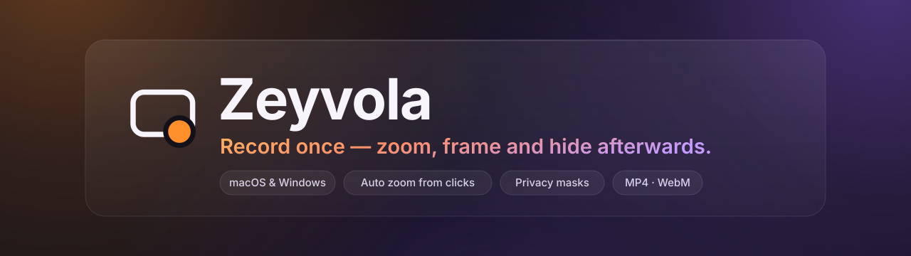
</p>

<p align="center">
  <b>Record your screen, camera and microphone separately — then shape the video afterwards:<br>automatic zoom from your clicks, privacy masks, camera layout and vertical formats, all on your own computer.</b>
</p>

<p align="center">
  <a href="https://github.com/YildizDikme/zeyvola-screen-recorder/releases/download/v0.1.0/Zeyvola-0.1.0-macos-arm64.dmg">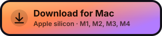</a>
  <a href="https://github.com/YildizDikme/zeyvola-screen-recorder/releases/download/v0.1.0/Zeyvola-0.1.0-macos-x64.dmg"></a>
  <a href="https://github.com/YildizDikme/zeyvola-screen-recorder/releases/download/v0.1.0/Zeyvola-0.1.0-windows-x64.zip"></a>
</p>

<p align="center">
  <sub>Version 0.1.0 · macOS 13+ (Apple silicon and Intel) · Windows 10 / 11 (64-bit)</sub>
</p>

| Computer | Download |
|---|---|
| Mac with Apple silicon (M1, M2, M3, M4 …) | [**Zeyvola-0.1.0-macos-arm64.dmg**](https://github.com/YildizDikme/zeyvola-screen-recorder/releases/download/v0.1.0/Zeyvola-0.1.0-macos-arm64.dmg) |
| Mac with an Intel processor | [**Zeyvola-0.1.0-macos-x64.dmg**](https://github.com/YildizDikme/zeyvola-screen-recorder/releases/download/v0.1.0/Zeyvola-0.1.0-macos-x64.dmg) |
| Windows 10 / 11 (64-bit) | [**Zeyvola-0.1.0-windows-x64.zip**](https://github.com/YildizDikme/zeyvola-screen-recorder/releases/download/v0.1.0/Zeyvola-0.1.0-windows-x64.zip) |

Which Mac? Apple menu › **About This Mac**: "Chip: Apple M…" → Apple silicon, "Processor: … Intel …" → Intel. · *Hangi Mac? Apple menüsü › **Bu Mac Hakkında**: "Çip: Apple M…" → Apple Silicon, "İşlemci: … Intel …" → Intel.*

All files, checksums and the FFmpeg source package: [Releases](https://github.com/YildizDikme/zeyvola-screen-recorder/releases). The app is not code-signed yet, so the first launch needs one extra click — see *Install* below. · *Uygulama henüz kod imzalı değil; ilk açılışta bir ek adım gerekir, aşağıdaki* Kurulum *bölümüne bakın.*

<p align="center"><b><a href="#english">English</a> · <a href="#türkçe">Türkçe</a></b></p>

<p align="center">
  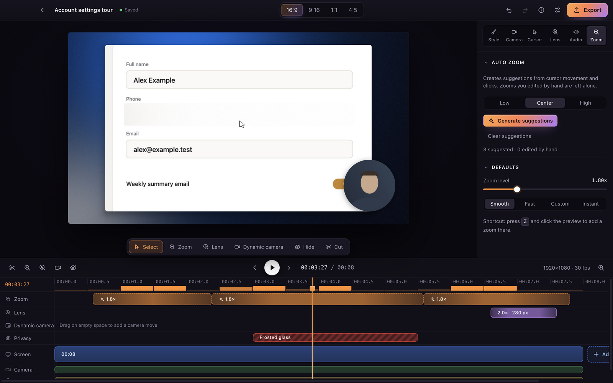
</p>

<p align="center">
  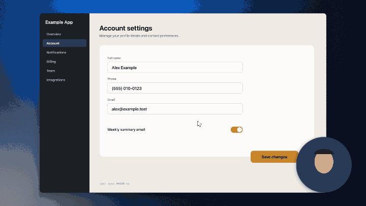
  <br><sub>Automatic zoom following a click · Tıklamayı izleyen otomatik zoom</sub>
</p>

| | |
|---|---|
| 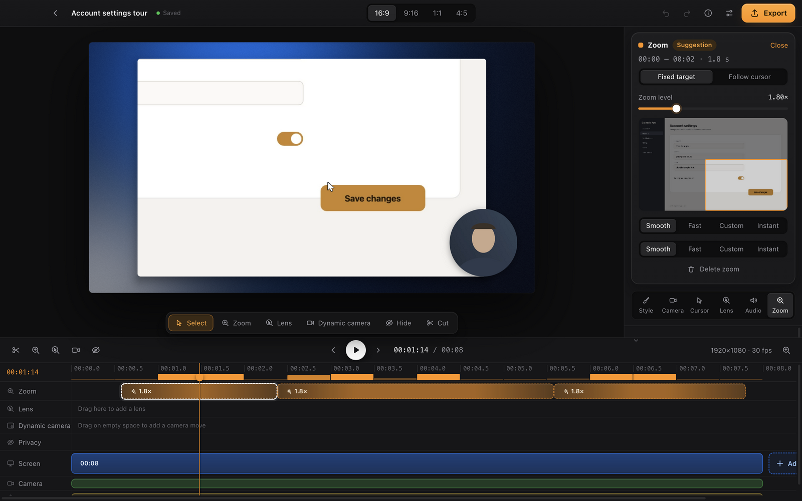 |  |
| *Zoom: suggested from your clicks, adjustable by hand · Tıklamalardan önerilir, elle ayarlanır* | *Privacy: frosted glass over sensitive data · Hassas bilgi buzlu camla kapatılır* |
|  |  |
| *One recording, several formats · Tek kayıt, birçok format* | *Export: MP4 or WebM, with a privacy check · Gizlilik kontrolüyle dışa aktarma* |

<details><summary>More screenshots</summary>


*The editor: automatic zoom suggestions on the timeline.*

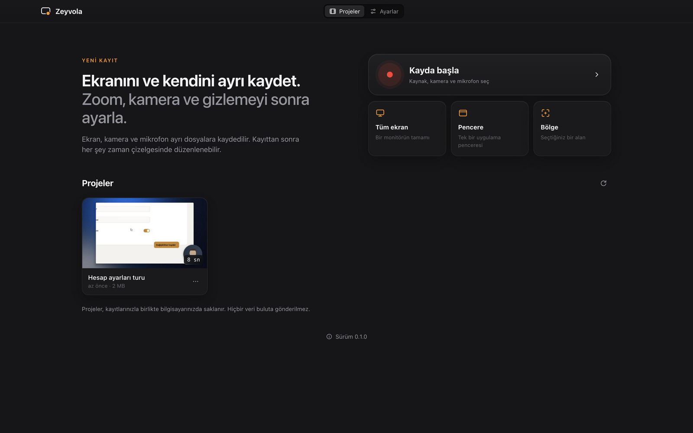
*Projects and quick start: full screen, window or region.*

</details>

*Screenshots come from a made-up sample project; no real screen, person or camera picture is shown. · Görüntüler uydurma bir örnek projedendir; gerçek bir ekran, kişi ya da kamera görüntüsü içermez.*

---

## English

### Why Zeyvola
- **Record once, decide later.** Screen, camera, microphone and system audio are recorded as separate tracks. Camera position and shape, zoom, background and format are all chosen after recording, on a timeline.
- **Zoom that follows your clicks.** Zeyvola suggests zooms from where you clicked and where the pointer rested. Keep them, move them, or draw your own; your own zooms are never overwritten.
- **Privacy that holds.** Cover any area with frosted glass, blur, pixelation or an opaque box. Every exported frame goes through these effects, and the export window shows the first and last frame of each covered area so you can check them before saving.
- **A lens for the details.** The lens (magnifier) follows the pointer in the ranges you choose, with its own size and zoom; it never reveals a covered area.
- **One recording, many formats.** 16:9, 9:16, 1:1 and 4:5, each with its own framing, from the same project.
- **Standard files.** Export **MP4** (H.264 + AAC, written by the operating system's own encoder; opens in the players built into macOS and Windows) or **WebM** (VP9 + Opus), at 1080p or 4K, 30 or 60 fps.
- **Your recordings stay yours.** Projects and recordings stay on your computer. Zeyvola makes no network requests, sends no telemetry and never records keystrokes.
- **Nothing lost to a crash.** If Zeyvola or its recorder stops during a recording, the recording is added back to its project the next time Zeyvola starts.
- **Turkish and English interface.** It follows your computer's language on first launch; you can change it any time.

Also on the timeline: trim, split, add videos (MP4, MOV, WebM), markers during recording, pause and resume, camera moves over time, themes and backgrounds, undo and redo.

### What's in 0.1.0
- **macOS** (Apple silicon and Intel), macOS 13 Ventura or later. Recording uses Zeyvola's macOS recording helper: system audio goes to its own track and the pointer is kept out of the video. The Intel package passed all of the app's own tests under Rosetta 2 on an Apple silicon Mac; it has not been tried on Intel hardware yet.
- **Windows 10 / 11** (64-bit). The automated tests passed on GitHub's Windows machine, and the app has been installed and used for recording on a real Windows PC. It has not been tried on every kind of hardware. On Windows, recording goes through the browser engine: system audio can be recorded and the pointer is part of the video.

Something not working? Please open an [Issue](https://github.com/YildizDikme/zeyvola-screen-recorder/issues).

### Install
**macOS**
1. Open the `.dmg` and drag **Zeyvola** onto the **Applications** shortcut.
2. Open Zeyvola from **Applications**. Because it is not signed with an Apple Developer ID, macOS blocks the first launch:
   - **macOS 15 and later:** try to open it once and close the warning. Go to **System Settings › Privacy & Security**, click **Open Anyway** for Zeyvola in the **Security** section and enter your login password. Apple shows this button for about an hour after the attempt.
   - **macOS 14 and earlier:** right-click (or Control-click) the app, choose **Open**, then **Open** again.

   This is needed on the first launch and may be needed again after downloading a new version.

**Windows**
1. Extract the `.zip` to a permanent folder (right-click › **Extract All**). Do not run the app from inside the zip.
2. Open `Zeyvola\Zeyvola.exe`.
3. Microsoft Defender SmartScreen may show **"Windows protected your PC"**: click **More info**, then **Run anyway**.
4. On first launch Zeyvola asks you to accept Microsoft's terms for `d3dcompiler_47.dll`, a Microsoft graphics file included in the Windows version. The terms cover only that file and do not change Zeyvola's license. **Read the terms** opens the full text. After **I accept**, Zeyvola restarts once and does not ask again; after **I do not accept**, it quits and asks next time.

<details><summary><b>Windows notes</b></summary>

- **SmartScreen:** Zeyvola is not code-signed, so SmartScreen warns on first launch. Company policy may block **Run anyway**.
- **Smart App Control:** If it is on in Windows 11 (Windows Security › App & browser control), Microsoft says it blocks unsigned apps and allows no exception for a single app, so Zeyvola will not start. Turning it off is your decision and affects the whole computer.
- **Windows N editions:** They lack Microsoft's media components; MP4 export is expected to fall back to WebM (not tried yet). Add the **Media Feature Pack** under Settings › Apps › Optional features.
- **Computers without a hardware video decoder** (for example some virtual machines): imported H.264 videos (MP4, MOV) may not preview. Zeyvola's own recordings are WebM and are not affected; a WebM copy of the video works.
- **The file `d3dcompiler_47.dll`** arrives as `d3dcompiler_47.dll.terms-pending` and gets its real name only after you accept the terms, so the app folder must be writable.

</details>

<details><summary><b>Permissions</b></summary>

**macOS** asks for each permission when it is first needed; you can change them in **System Settings › Privacy & Security**:
- **Screen & System Audio Recording** (**Screen Recording** on older macOS): for the screen and system audio. macOS asks on the first recording; quit and reopen Zeyvola after allowing it.
- **Camera** and **Microphone**: when you use them in a recording. Their status is also shown, and can be requested, in Zeyvola's **Settings**.
- The click helper watches only mouse buttons and scrolling. It needs no extra permission and does not read the keyboard.

Without a Developer ID signature, macOS may ask for screen recording again after an update. If it keeps an old entry and still blocks recording, remove the Zeyvola row with "−", reopen Zeyvola and allow it again; restart the Mac if needed.

**Windows** needs no separate permission for screen recording and clicks. If the camera or microphone does not work, allow desktop apps under **Settings › Privacy & security › Camera** (or **Microphone**); this applies to all desktop apps.

</details>

<details><summary><b>Uninstall</b></summary>

Removing the app does **not** delete your projects; delete them yourself if you want.

| | macOS | Windows |
|---|---|---|
| App | Move `Zeyvola` from **Applications** to the Trash | Delete the extracted folder (there is no installer) |
| Projects and recordings | `~/Movies/Zeyvola Projeleri` | `Zeyvola Projeleri` in your **Videos** folder |
| Settings | `~/Library/Application Support/Zeyvola` | `%APPDATA%\Zeyvola` |

Exported videos stay where you saved them. On macOS you can also remove Zeyvola's rows under **System Settings › Privacy & Security** with "−".

</details>

<details><summary><b>Troubleshooting</b></summary>

- **No "Open Anyway" button (macOS):** it appears for about an hour after you try to open the app. Try again, then return to **Privacy & Security**.
- **Recording does not start (macOS):** the screen recording permission is missing or went stale after an update; see *Permissions*.
- **MP4 export:** written with the operating system's encoder. On Windows without a hardware H.264 encoder, Windows' software encoder is used (slower); without that, the video is saved as WebM and Zeyvola tells you before and after the export. WebM is always available.
- **Recording looks squeezed (Windows):** on some computers the screen arrives in a different shape. Zeyvola shows it with the display's real shape and says so; one direction may have slightly less detail.
- **The app does not open (Windows):** Smart App Control may be on, or the app was started from inside the zip.
- **Check a download (optional):** compare it with `SHA256SUMS.txt` from the Release: `shasum -a 256 <file>` on macOS, `Get-FileHash <file>` in PowerShell.

</details>

### Privacy
Recordings, cursor data and projects stay on your computer. Zeyvola makes no network requests and sends no telemetry. Keystrokes are not recorded. Clicks are stored locally only, for zoom suggestions.

### Developer
Zeyvola is developed by **Yıldız Dikme** (Independent Software Developer) · GitHub: [YildizDikme](https://github.com/YildizDikme). Copyright © 2026 Yıldız Dikme.

### License
Zeyvola's source code is published under the **[PolyForm Shield License 1.0.0](LICENSE)**. It is a source-available license, not an open-source license in the OSI sense. The required notice lines are in [`NOTICE`](NOTICE).

In short (the license text governs; this summary adds nothing to it): individuals, companies and institutions may use, copy, modify and distribute Zeyvola free of charge. The license claims no rights in the videos, recordings and projects you make with it and does not limit their commercial use. The one purpose it does not permit is providing a product that competes with Zeyvola or with a product the licensor provides using it; under the license a product can compete even when it is free, and one marketed as a practical substitute for Zeyvola definitely competes.

For the name and logo: [TRADEMARKS.md](TRADEMARKS.md).

### Third-party software
Zeyvola is built on Electron (Chromium) and a few JavaScript packages, each under its own license.
- License texts: [docs/THIRD_PARTY_NOTICES.md](docs/THIRD_PARTY_NOTICES.md); in the app: **Settings › Licenses and third-party software**.
- FFmpeg (LGPL-2.1 or later): Electron's library built without proprietary codecs, shipped unchanged as a separate, dynamically linked file. The corresponding source is published with every release. You may replace the library with a compatible build and then re-sign the app.
- MP4 export writes H.264 video and AAC sound produced by the operating system's own encoders (macOS VideoToolbox and AudioToolbox, Windows Media Foundation), not by the app's code. No H.264 or AAC encoder is added to the app, and Electron's software H.264 encoder (OpenH264) is not used. On Windows without a hardware H.264 encoder, Windows' own software encoder is used (through `native/helper-windows`); otherwise the video is saved as WebM and the app says so.
- H.264 and AAC are patented codecs with royalty-bearing patent pools. How using the operating system's encoders affects those obligations is not legally settled, and this project gives no assurance about it. Details: [docs/THIRD_PARTY_NOTICES.md](docs/THIRD_PARTY_NOTICES.md) (codec table).
- WebM export uses VP9 + Opus. Their developers (Google, Xiph.Org) grant royalty-free licenses for their own patents; no assurance is given about third-party patent claims.

<details><summary><b>Building from source</b></summary>

Requirements: macOS (Apple silicon); Node.js 22.12+ (see `.nvmrc`; `nvm use` in the repository root); pnpm 10 (see `packageManager` in `package.json`); Xcode Command Line Tools (`xcode-select --install`) — packaging, the native helpers and the audit tools call `swiftc`, `clang`, `codesign`, `lipo`, `otool`, `objdump`, `ditto`, `hdiutil` and `PlistBuddy`, and `pnpm start` signs the development bundle with `codesign`.

```bash
nvm use                       # Node version from .nvmrc
pnpm install
pnpm --filter @zeyvola/desktop exec node node_modules/electron/install.js   # Electron binary
pnpm dev                      # build and open the app (pnpm build && pnpm start)
pnpm test && pnpm typecheck   # unit tests and type check
pnpm package                  # macOS package → apps/desktop/out/mp4/darwin-<arch>/
pnpm codec-audit -- apps/desktop/out/mp4/darwin-arm64 --profile mp4 --probe --release
```

`pnpm package` builds the published configuration by default (`ZEYVOLA_DIST=mp4`: the macOS recording helper; MP4 as H.264 + AAC, WebM as VP9 + Opus). The helper is built as a universal binary (arm64 + x86_64) by `native/recorder-macos/build.sh`. `--profile webm` is the configuration without the helper, recording through the browser engine only. Packages are ad-hoc signed for local testing.

In-app test suites (temporary projects folder, synthetic camera and microphone; your own projects are never read; need a display and a GPU):
- `pnpm smoke`: builds the app and self-tests the renderer stack (WebGL2 compositor, privacy effects, WebCodecs encoders, MP4/WebM writers) and reports what this machine supports.
- `pnpm perftest`: times automatic zoom, playback and export.
- `pnpm uitest`: drives the main flow through the interface and also opens every exported MP4 with macOS's own decoder (AVFoundation).
- `node tests/media-check/av-check.mjs <file.mp4>`: checks an MP4 with AVFoundation (H.264 video, AAC sound, non-empty frames, duration).
- `pnpm docshots`: renders the README screenshots from the sample project.

Other notes:
- `tests/real-capture/` records the real screen; it needs the Swift compiler and the macOS screen recording permission and is not part of `pnpm test` (see [tests/real-capture/README.md](tests/real-capture/README.md)).
- `pnpm native:win` (Windows helper) needs the Zig compiler at `tools/.cache/zig/zig` or via `ZIG`; Zig is not in the repository.
- The app makes no network requests, but some build and release tools do: `pnpm install` and the Electron download, `tools/ffmpeg-source.mjs` and `tools/electron-artifacts.mjs`.

Structure:
- `apps/desktop`: Electron main process, preload and React interface
- `packages/timing`: tick-based time
- `packages/project-model`: document schema, commands, undo/redo, `evaluate()`
- `packages/zoom-engine`: automatic zoom suggestions
- `packages/compositor`: WebGL2 renderer (preview and export)
- `packages/media-web`: MP4 and WebM writers
- `packages/protocol`: IPC contract and validation
- `native/input-macos`: click helper (mouse buttons and scrolling; no codecs)
- `native/recorder-macos`: macOS recording helper (ScreenCaptureKit; screen and camera as H.264 through macOS's encoder, sound as Opus)
- `native/helper-windows`: Windows helper (clicks, imported audio, Media Foundation MP4)
- `tools/`: license notices, codec audit, FFmpeg source package

</details>

### Contributing
Bug reports and suggestions are welcome as [Issues](https://github.com/YildizDikme/zeyvola-screen-recorder/issues). Code contributions (pull requests) are not accepted for now. Security problems: see [SECURITY.md](SECURITY.md).

---

## Türkçe

<p align="center">
  <b>Ekranı, kamerayı ve mikrofonu ayrı kaydet — videoyu sonra şekillendir:<br>tıklamalardan otomatik zoom, gizleme alanları, kamera yerleşimi ve dikey formatlar; hepsi kendi bilgisayarında.</b>
</p>

<p align="center">
  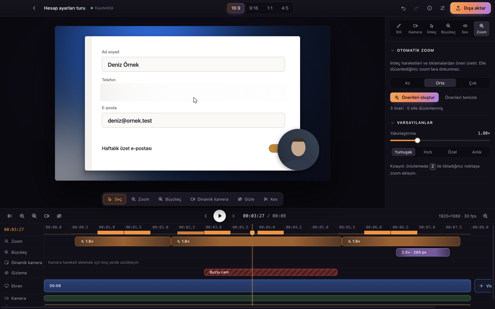
</p>

<p align="center"><sub>İndirme bağlantıları sayfanın en üstünde. · <a href="#english">English</a></sub></p>

<details><summary>Türkçe arayüzden diğer görüntüler</summary>

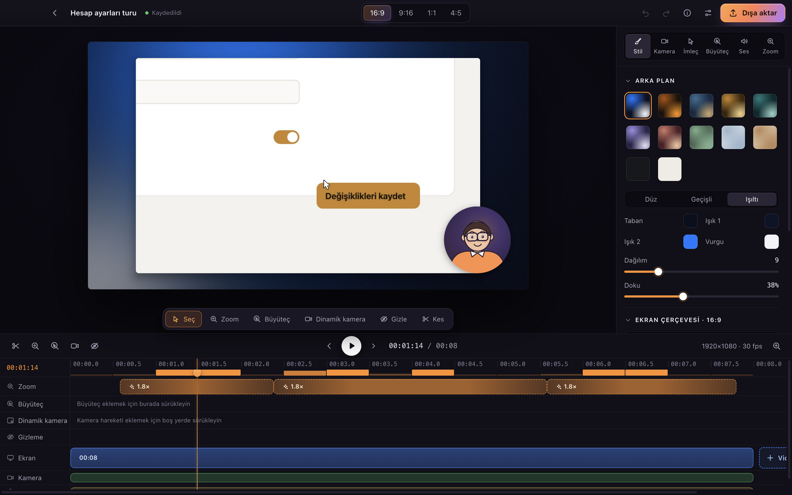
*Düzenleyici: otomatik zoom önerileri zaman çizelgesinde.*

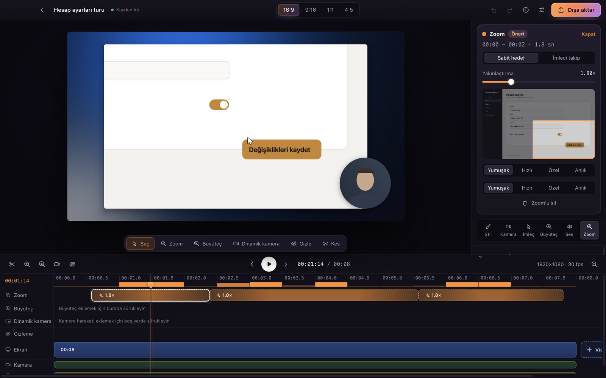
*Zoom: tıklamalardan önerilir, elle ayarlanır.*

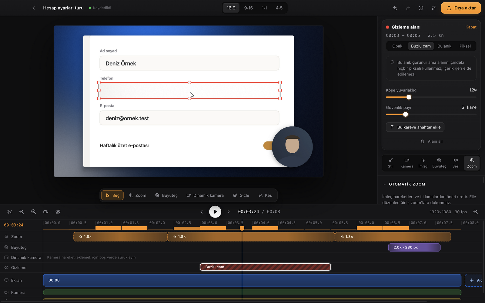
*Gizleme: hassas bilgi buzlu camla kapatılır.*

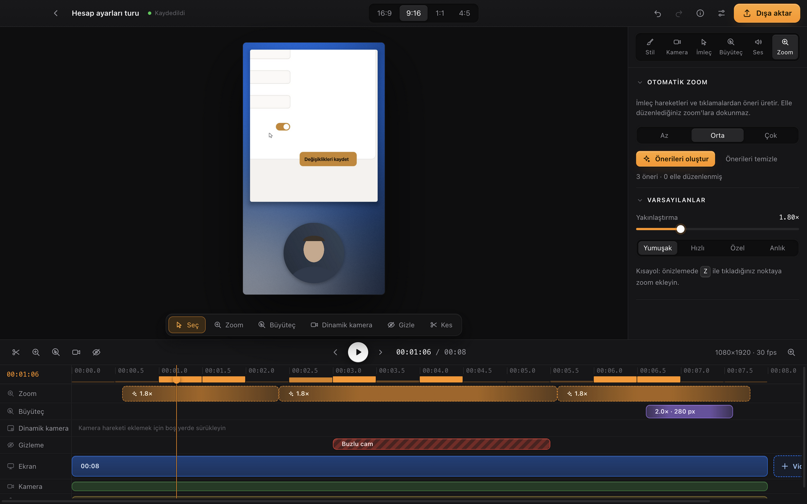
*Tek kayıt, birçok format.*

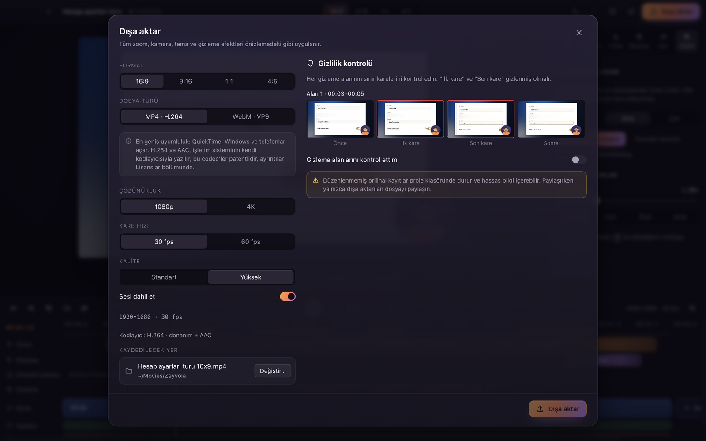
*Dışa aktarma: MP4 ya da WebM, gizlilik kontrolüyle.*

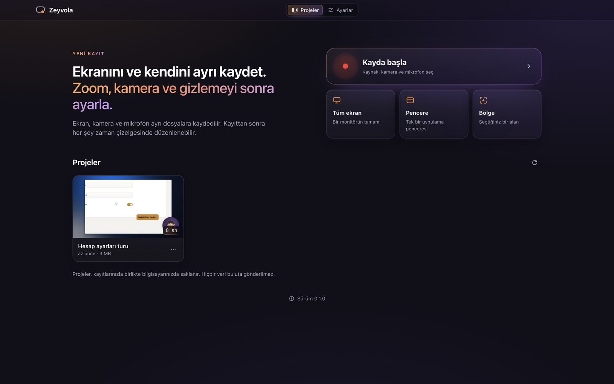
*Projeler ve hızlı başlangıç: tüm ekran, pencere ya da bölge.*

</details>

### Neden Zeyvola
- **Bir kez kaydet, sonra karar ver.** Ekran, kamera, mikrofon ve sistem sesi ayrı izlere kaydedilir. Kameranın yeri ve şekli, zoom, arka plan ve format kayıttan sonra, zaman çizelgesinde seçilir.
- **Tıklamalarını izleyen zoom.** Zeyvola, tıkladığınız ve imlecin durduğu yerlerden zoom önerir. Önerileri tutun, taşıyın ya da kendiniz çizin; elle eklediğiniz zoom'lara dokunulmaz.
- **Gerçekten gizleyen gizleme.** Herhangi bir alanı buzlu cam, bulanıklık, piksel ya da opak kutuyla kapatın. Dışa aktarılan her kare bu efektlerden geçer; dışa aktarma penceresi her gizleme alanının ilk ve son karesini gösterir, kaydetmeden önce kontrol edersiniz.
- **Ayrıntı için büyüteç.** Büyüteç, seçtiğiniz aralıklarda imleci takip eder; boyutu ve yakınlaştırması ayrı ayarlanır. Gizlenen alanları açığa çıkarmaz.
- **Tek kayıt, birçok format.** Aynı projeden 16:9, 9:16, 1:1 ve 4:5; her biri kendi çerçeve ayarıyla.
- **Standart dosyalar.** **MP4** (H.264 + AAC, işletim sisteminin kendi kodlayıcısıyla; macOS ve Windows'un kendi oynatıcıları açar) ya da **WebM** (VP9 + Opus); 1080p veya 4K, 30 veya 60 fps.
- **Kayıtlarınız sizde kalır.** Projeler ve kayıtlar bilgisayarınızda kalır. Zeyvola ağ isteği yapmaz, telemetri göndermez, tuş vuruşlarını kaydetmez.
- **Çökme kaydı götürmez.** Kayıt sırasında Zeyvola ya da kayıt yardımcısı kapanırsa, kayıt bir sonraki açılışta projesine geri eklenir.
- **Türkçe ve İngilizce arayüz.** İlk açılışta bilgisayarınızın diline uyar; istediğiniz zaman değiştirebilirsiniz.

Zaman çizelgesinde ayrıca: kesme, bölme, video ekleme (MP4, MOV, WebM), kayıt sırasında işaret koyma, duraklatma ve devam, zaman içinde kamera hareketi, temalar ve arka planlar, geri al ve yinele.

### 0.1.0'da neler var
- **macOS** (Apple Silicon ve Intel), macOS 13 Ventura ve sonrası. Kayıt, Zeyvola'nın macOS kayıt yardımcısıyla yapılır: sistem sesi ayrı bir ize, imleç videodan ayrı kaydedilir. Intel paketi bir Apple Silicon Mac'te Rosetta 2 altında uygulamanın kendi testlerinin tamamından geçti; Intel donanımında henüz denenmedi.
- **Windows 10 / 11** (64 bit). Otomatik testler GitHub'ın Windows makinesinde geçti; uygulama gerçek bir Windows bilgisayarda kurulup kayıt yapılarak denendi. Her donanımda denenmedi. Windows'ta kayıt tarayıcı motoru üzerinden yapılır: sistem sesi kaydedilebilir, imleç videoya gömülür.

Bir sorun mu var? Lütfen bir [Issue](https://github.com/YildizDikme/zeyvola-screen-recorder/issues) açın.

### Kurulum
**macOS**
1. `.dmg` dosyasını açın ve **Zeyvola**'yı **Applications** (Uygulamalar) kısayoluna sürükleyin.
2. Zeyvola'yı **Uygulamalar** klasöründen açın. Apple Developer ID ile imzalanmadığı için macOS ilk açılışı engeller:
   - **macOS 15 ve sonrası:** Uygulamayı bir kez açmayı deneyin ve uyarıyı kapatın. **Sistem Ayarları › Gizlilik ve Güvenlik** bölümünde, **Güvenlik** kısmında Zeyvola için **Yine de Aç**'a tıklayın ve giriş parolanızı girin. Apple bu düğmeyi denemeden sonra yaklaşık bir saat gösterir.
   - **macOS 14 ve öncesi:** Uygulamaya sağ tıklayıp (ya da Control tuşuyla tıklayıp) **Aç**'ı, sonra yeniden **Aç**'ı seçin.

   Bu adım ilk açılışta gerekir; yeni bir sürümü indirdiğinizde yeniden gerekebilir.

**Windows**
1. `.zip` dosyasını kalıcı bir klasöre çıkarın (sağ tık › **Tümünü ayıkla** / *Extract All*). Uygulamayı zip'in içinden çalıştırmayın.
2. `Zeyvola\Zeyvola.exe` dosyasını açın.
3. Microsoft Defender SmartScreen **"Windows bilgisayarınızı korudu"** uyarısını gösterebilir: **Ek bilgi**'ye, sonra **Yine de çalıştır**'a tıklayın (*More info › Run anyway*).
4. İlk açılışta Zeyvola, Windows sürümünde bulunan Microsoft grafik dosyası `d3dcompiler_47.dll` için Microsoft'un koşullarını sorar. Koşullar yalnızca bu dosya için geçerlidir ve Zeyvola'nın lisansını değiştirmez. **Koşulları oku** tam metni açar. **Kabul ediyorum** derseniz Zeyvola bir kez yeniden başlar ve bir daha sormaz; **Kabul etmiyorum** derseniz kapanır ve bir sonraki açılışta yeniden sorar.

<details><summary><b>Windows notları</b></summary>

- **SmartScreen:** Zeyvola kod imzalı olmadığı için SmartScreen ilk açılışta uyarır. Kurumsal politika **Yine de çalıştır**'ı engelleyebilir.
- **Akıllı Uygulama Denetimi (Smart App Control):** Windows 11'de açıksa (Windows Güvenliği › Uygulama ve tarayıcı denetimi), Microsoft'a göre imzasız uygulamaları engeller ve tek bir uygulama için istisna tanımlanamaz; Zeyvola açılmaz. Özelliği kapatmak sizin kararınızdır ve bütün bilgisayarı etkiler.
- **Windows N sürümleri:** Microsoft'un medya bileşenleri yoktur; MP4 yerine WebM'e düşülmesi beklenir (henüz denenmedi). **Ayarlar › Uygulamalar › İsteğe bağlı özellikler** altından **Media Feature Pack**'i ekleyin.
- **Donanım video çözücüsü olmayan bilgisayarlar** (ör. bazı sanal makineler): İçe aktarılan H.264 videoların (MP4, MOV) önizlemesi çalışmayabilir. Zeyvola'nın kendi kayıtları WebM olduğu için etkilenmez; videonun WebM kopyası çalışır.
- **`d3dcompiler_47.dll` dosyası** `d3dcompiler_47.dll.terms-pending` adıyla gelir ve koşulları kabul edince asıl adını alır; bu yüzden uygulama klasörüne yazılabilmelidir.

</details>

<details><summary><b>İzinler</b></summary>

**macOS** her izni ilk gerektiğinde ister; **Sistem Ayarları › Gizlilik ve Güvenlik** altından değiştirebilirsiniz:
- **Ekran ve Sistem Ses Kaydı** (eski macOS'ta **Ekran Kaydı**): ekran ve sistem sesi için. macOS ilk kayıtta sorar; izni verdikten sonra Zeyvola'yı kapatıp yeniden açın.
- **Kamera** ve **Mikrofon**: kayıtta kullandığınızda. Durumları Zeyvola'nın **Ayarlar** ekranında da görünür ve oradan istenebilir.
- Tıklama yardımcısı yalnızca fare tuşlarını ve kaydırmayı izler. Ek izin gerektirmez, klavyeyi okumaz.

Developer ID imzası olmadığı için macOS güncellemeden sonra ekran kaydı iznini yeniden isteyebilir. Eski kaydı tutup yine engellerse Zeyvola satırını "−" ile kaldırın, Zeyvola'yı yeniden açıp izni yeniden verin; gerekirse Mac'i yeniden başlatın.

**Windows**'ta ekran kaydı ve tıklamalar için ayrı izin gerekmez. Kamera ya da mikrofon çalışmıyorsa **Ayarlar › Gizlilik ve güvenlik › Kamera** (ya da **Mikrofon**) altında masaüstü uygulamalarına izin verin; bu ayar bütün masaüstü uygulamaları için geçerlidir.

</details>

<details><summary><b>Kaldırma</b></summary>

Uygulamayı silmek projelerinizi **silmez**; isterseniz kendiniz silin.

| | macOS | Windows |
|---|---|---|
| Uygulama | **Uygulamalar**'daki `Zeyvola`'yı Çöp Sepeti'ne taşıyın | Çıkardığınız klasörü silin (kurulum programı yoktur) |
| Projeler ve kayıtlar | `~/Movies/Zeyvola Projeleri` (Finder'da **Filmler**) | **Videolar** klasörünüzdeki `Zeyvola Projeleri` |
| Ayarlar | `~/Library/Application Support/Zeyvola` | `%APPDATA%\Zeyvola` |

Dışa aktardığınız videolar kaydettiğiniz yerde kalır. macOS'ta **Sistem Ayarları › Gizlilik ve Güvenlik** altındaki Zeyvola satırlarını da "−" ile kaldırabilirsiniz.

</details>

<details><summary><b>Sorun giderme</b></summary>

- **"Yine de Aç" düğmesi yok (macOS):** Düğme, açmayı denedikten sonra yaklaşık bir saat görünür. Yeniden deneyin, sonra **Gizlilik ve Güvenlik**'e dönün.
- **Kayıt başlamıyor (macOS):** Ekran kaydı izni yok ya da güncellemeden sonra geçersiz kaldı; *İzinler*'e bakın.
- **MP4 dışa aktarma:** İşletim sisteminin kodlayıcısıyla yazılır. Windows'ta ekran kartının H.264 kodlayıcısı yoksa Windows'un yazılım kodlayıcısı kullanılır (daha yavaş); o da yoksa video WebM olarak kaydedilir ve Zeyvola bunu dışa aktarmadan önce ve sonra söyler. WebM her zaman seçilebilir.
- **Kayıt basık görünüyor (Windows):** Bazı bilgisayarlarda ekran görüntüsü kayda farklı oranda gelir. Zeyvola ekranın gerçek oranıyla gösterir ve bunu söyler; bir yönde ayrıntı biraz az olabilir.
- **Uygulama açılmıyor (Windows):** Akıllı Uygulama Denetimi açık olabilir ya da uygulama zip'in içinden çalıştırılmıştır.
- **İndirmeyi doğrulama (isteğe bağlı):** Release'teki `SHA256SUMS.txt` ile karşılaştırın: macOS'ta `shasum -a 256 <dosya>`, PowerShell'de `Get-FileHash <dosya>`.
- **Gerçek bir Windows bilgisayarda deneyip bildirmek için:** [Windows deneme listesi](docs/windows-deneme-listesi.md).

</details>

### Gizlilik
Kayıtlar, imleç verileri ve projeler bilgisayarınızda kalır. Zeyvola ağ isteği yapmaz ve telemetri göndermez. Tuş vuruşları kaydedilmez. Tıklamalar yalnızca zoom önerileri için ve yalnızca yerelde saklanır.

### Geliştirici
Zeyvola'yı **Yıldız Dikme** (Independent Software Developer) geliştirir · GitHub: [YildizDikme](https://github.com/YildizDikme). Copyright © 2026 Yıldız Dikme.

### Lisans
Zeyvola'nın kaynak kodu **[PolyForm Shield License 1.0.0](LICENSE)** ile yayımlanır. Bu lisans "kaynağı açık" (source-available) bir lisanstır; OSI anlamında açık kaynak değildir. Gerekli bildirim satırları [`NOTICE`](NOTICE) dosyasındadır.

Kısaca (bağlayıcı olan lisans metnidir; bu özet ona bir şey eklemez):
- Zeyvola'yı kişiler, şirketler ve kurumlar ücretsiz kullanabilir; kopyalayabilir, değiştirebilir ve dağıtabilir.
- Lisans, Zeyvola ile yaptığınız videolar, kayıtlar ve projeler üzerinde hak iddia etmez ve ticari kullanımlarını sınırlamaz.
- İzin verilmeyen tek amaç, Zeyvola ile ya da lisans verenin Zeyvola'yı kullanarak sunduğu bir ürünle **rekabet eden bir ürün sağlamaktır**. Lisansa göre bir ürün ücretsiz olsa da rakip olabilir; Zeyvola'nın yerine geçecek şekilde sunulan bir ürün kesinlikle rakiptir.
- Bir kullanımın rekabet sayılıp sayılmadığı her durumda lisans metnine göre değerlendirilir.

"Zeyvola" adı ve logosu için: [TRADEMARKS.md](TRADEMARKS.md).

### Üçüncü taraf yazılımlar
Zeyvola, Electron (Chromium) ve birkaç JavaScript paketi üzerine kuruludur; her bileşen kendi lisansıyla dağıtılır.
- Lisans metinleri: [docs/THIRD_PARTY_NOTICES.md](docs/THIRD_PARTY_NOTICES.md); uygulama içinde: **Ayarlar › Lisanslar ve üçüncü taraf yazılımlar**.
- FFmpeg (LGPL-2.1 veya üstü): Electron'un tescilli codec'ler olmadan derlenmiş kitaplığı değiştirilmeden, ayrı ve dinamik bağlı bir dosya olarak dağıtılır. Karşılık gelen kaynak kodu her sürümle yayımlanır. Kitaplığı uyumlu bir sürümle değiştirebilirsiniz; ardından uygulamayı yeniden imzalayın.
- MP4 dışa aktarma H.264 görüntü ve AAC ses yazar; bunları uygulamanın kendi kodu değil, işletim sisteminin kodlayıcısı üretir (macOS: VideoToolbox ve AudioToolbox; Windows: Media Foundation). Uygulamaya H.264 ya da AAC kodlayıcısı eklenmez; Electron'un içindeki yazılım H.264 kodlayıcısı (OpenH264) kullanılmaz. Windows'ta ekran kartının H.264 kodlayıcısı yoksa Windows'un kendi yazılım kodlayıcısı kullanılır (`native/helper-windows` aracılığıyla); o da yoksa video WebM olarak kaydedilir ve uygulama bunu söyler.
- H.264 ve AAC patentli codec'lerdir; telif ücretli patent havuzları vardır. İşletim sisteminin kodlayıcısını kullanmanın bu yükümlülükleri nasıl etkilediği hukuken netleşmemiştir; bu proje bu konuda bir güvence vermez. Ayrıntılar: [docs/THIRD_PARTY_NOTICES.md](docs/THIRD_PARTY_NOTICES.md) (codec tablosu).
- WebM dışa aktarma VP9 + Opus ile yapılır. Bu biçimlerin geliştiricileri (Google, Xiph.Org) kendi patentleri için telifsiz izin verir; üçüncü kişilerin patent iddiaları için bir güvence verilmez.

<details><summary><b>Kaynaktan derleme</b></summary>

Gereksinimler: macOS (Apple Silicon); Node.js 22.12+ (`.nvmrc`; depo kökünde `nvm use`); pnpm 10 (`package.json` içindeki `packageManager`); Xcode komut satırı araçları (`xcode-select --install`) — paketleme, yerel yardımcılar ve denetim araçları `swiftc`, `clang`, `codesign`, `lipo`, `otool`, `objdump`, `ditto`, `hdiutil` ve `PlistBuddy` kullanır; `pnpm start` geliştirme paketini `codesign` ile imzalar.

```bash
nvm use                       # .nvmrc'deki Node sürümü
pnpm install
pnpm --filter @zeyvola/desktop exec node node_modules/electron/install.js   # Electron ikili dosyası
pnpm dev                      # derle ve uygulamayı aç (pnpm build && pnpm start)
pnpm test && pnpm typecheck   # birim testleri ve tip denetimi
pnpm package                  # macOS paketi → apps/desktop/out/mp4/darwin-<arch>/
pnpm codec-audit -- apps/desktop/out/mp4/darwin-arm64 --profile mp4 --probe --release
```

`pnpm package` varsayılan olarak yayımlanan yapılandırmayı (`ZEYVOLA_DIST=mp4`: macOS kayıt yardımcısı; MP4 H.264 + AAC, WebM VP9 + Opus) derler. Kayıt yardımcısı `native/recorder-macos/build.sh` ile evrensel ikili (arm64 + x86_64) olarak derlenir. `--profile webm`, kayıt yardımcısı olmadan yalnızca tarayıcı motoruyla kaydeden yapılandırmadır. Paketler yerel test için geçici imzalanır.

Uygulama içi test takımları (geçici proje klasörü, sentetik kamera ve mikrofon; kendi projeleriniz okunmaz; ekran ve GPU gerekir):
- `pnpm smoke`: uygulamayı derler ve arayüz katmanını kendi kendine dener (WebGL2 kompozitör, gizleme efektleri, WebCodecs kodlayıcıları, MP4/WebM yazıcıları); bu makinenin neleri desteklediğini raporlar.
- `pnpm perftest`: otomatik zoom, oynatma ve dışa aktarma sürelerini ölçer.
- `pnpm uitest`: ana akışı arayüz üzerinden sürer; dışa aktarılan her MP4'ü macOS'un kendi çözücüsüyle (AVFoundation) de açar.
- `node tests/media-check/av-check.mjs <dosya.mp4>`: bir MP4'ü AVFoundation ile denetler (H.264 görüntü, AAC ses, boş olmayan kare, süre).
- `pnpm docshots`: örnek projeden README ekran görüntülerini üretir.

Diğer notlar:
- `tests/real-capture/` gerçek ekran kaydı yapar; Swift derleyicisi ve macOS ekran kaydı izni ister, `pnpm test`'e dahil değildir (bkz. [tests/real-capture/README.md](tests/real-capture/README.md)).
- `pnpm native:win` (Windows yardımcısı) Zig derleyicisi ister: `tools/.cache/zig/zig` yolunda ya da `ZIG` ile. Zig depoda yoktur.
- Uygulama ağ isteği yapmaz; ancak bazı derleme ve yayın araçları ağ ister: `pnpm install` ve Electron indirmesi, `tools/ffmpeg-source.mjs` ve `tools/electron-artifacts.mjs`.

Yapı:
- `apps/desktop`: Electron ana süreç, preload ve React arayüzü
- `packages/timing`: tick tabanlı zaman
- `packages/project-model`: belge şeması, komutlar, geri al/yinele, `evaluate()`
- `packages/zoom-engine`: otomatik zoom önerileri
- `packages/compositor`: WebGL2 render motoru (önizleme ve dışa aktarma)
- `packages/media-web`: MP4 ve WebM yazıcıları
- `packages/protocol`: IPC sözleşmesi ve doğrulama
- `native/input-macos`: tıklama yardımcısı (fare tuşları ve kaydırma; codec içermez)
- `native/recorder-macos`: macOS kayıt yardımcısı (ScreenCaptureKit; ekranı ve kamerayı macOS'un kodlayıcısıyla H.264, sesi Opus olarak yazar)
- `native/helper-windows`: Windows yardımcısı (tıklamalar, eklenen videonun sesi, Media Foundation ile MP4)
- `tools/`: lisans bildirimleri, codec denetimi, FFmpeg kaynak paketi

</details>

### Katkı
Hata bildirimleri ve öneriler için [Issues](https://github.com/YildizDikme/zeyvola-screen-recorder/issues) kullanılabilir. Şimdilik dışarıdan kod katkısı (pull request) kabul edilmiyor. Güvenlik açıkları için: [SECURITY.md](SECURITY.md).
